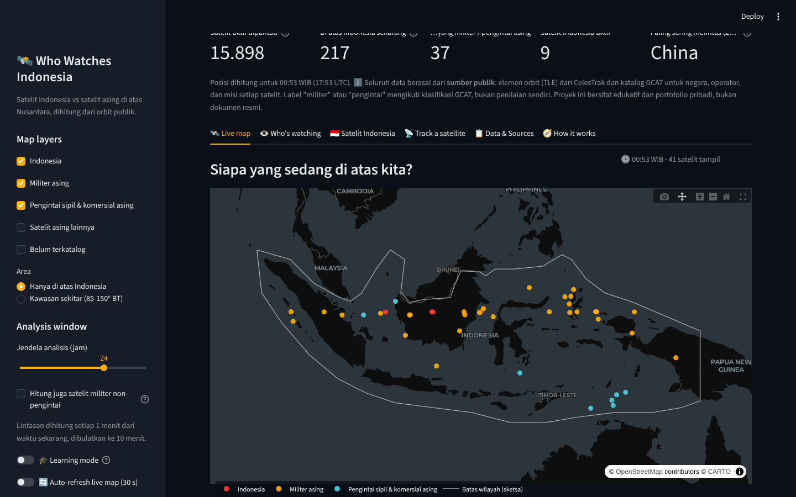
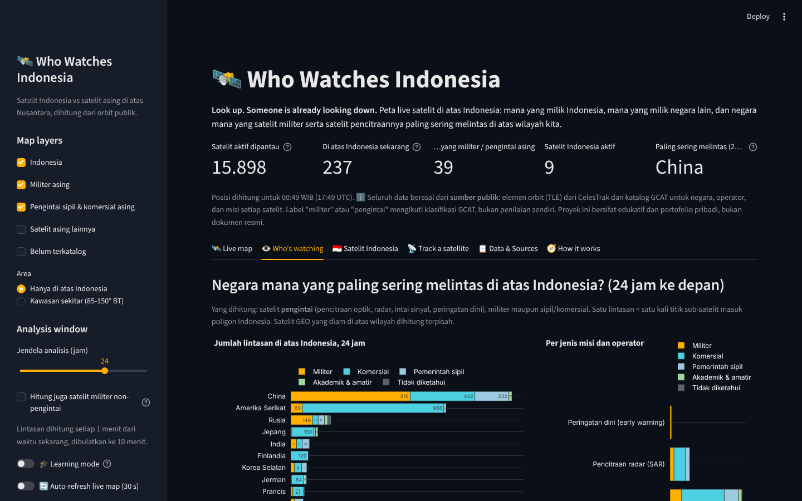
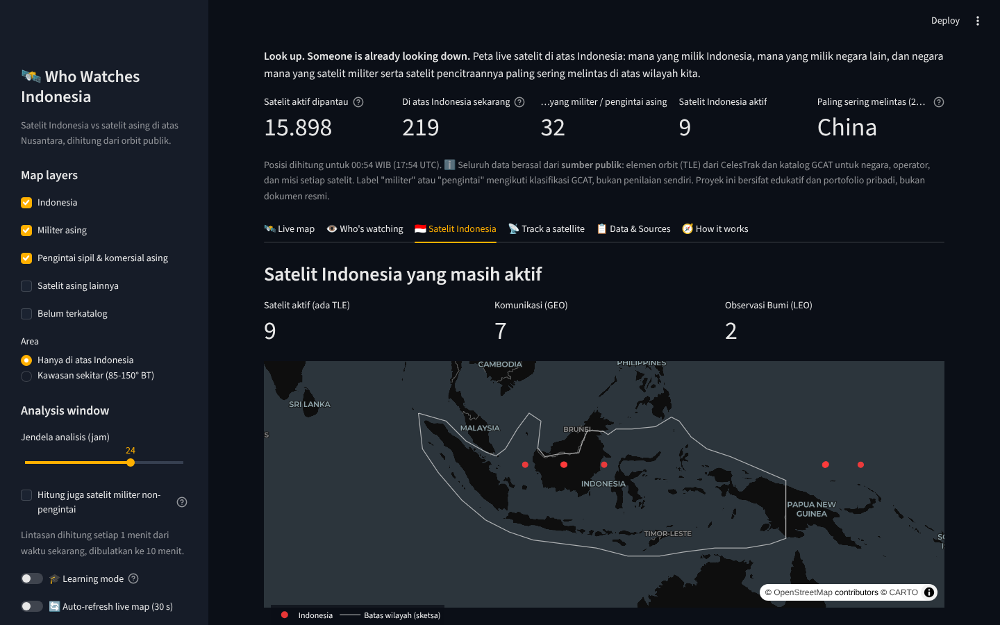
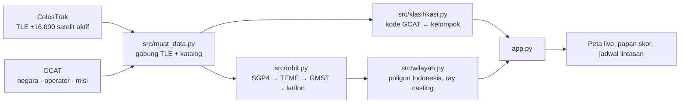

# 🛰️ Who Watches Indonesia

[](https://github.com/Avalon2222/who-watches-indonesia/actions/workflows/tests.yml) [](https://www.python.org/) [](LICENSE) [](https://who-watches-indonesia.streamlit.app)

> Peta live satelit di atas Indonesia: **satelit Indonesia** vs **satelit asing**, siapa yang sedang lewat sekarang,
> dan negara mana yang satelit militer serta satelit pencitraannya paling sering melintas di atas wilayah kita.
> Dihitung langsung dari elemen orbit publik (TLE) dengan Python, sgp4, Plotly, dan Streamlit.

*Look up. Someone is already looking down. A live satellite tracker over Indonesia that separates Indonesian
satellites from foreign ones, counts how often military and imaging satellites of each country pass over the
archipelago, and shows which geostationary satellites are parked above it permanently. Built from public orbital
elements (CelesTrak) and the GCAT catalog with Python, sgp4, Plotly and Streamlit.*

**🚀 Coba langsung di browser:** [who-watches-indonesia.streamlit.app](https://who-watches-indonesia.streamlit.app)



> ℹ️ **Disclaimer.** Seluruh data berasal dari **sumber publik**: elemen orbit dari CelesTrak dan katalog GCAT
> (Jonathan McDowell) untuk negara, operator, dan misi setiap satelit. Label "militer" atau "pengintai" mengikuti
> klasifikasi GCAT, bukan penilaian sendiri. Batas wilayah adalah poligon sketsa, bukan batas resmi. Proyek ini
> bersifat edukatif dan portofolio pribadi, bukan dokumen resmi, serta tidak berafiliasi dengan instansi mana pun.

## Latar belakang

Setiap hari ratusan satelit melintas di atas Indonesia, dan hampir semuanya bukan milik Indonesia. Sebagian hanya
satelit komunikasi atau navigasi yang kebetulan lewat; sebagian lagi memang dibuat untuk memotret, merekam sinyal,
atau mengawasi permukaan Bumi. Pertanyaannya sederhana: **siapa saja mereka, seberapa sering, dan jam berapa?**

Data untuk menjawabnya ternyata terbuka. Elemen orbit setiap satelit yang dilacak jaringan radar Amerika dipublikasikan
lewat CelesTrak, dan katalog GCAT mencatat negara, operator, dan misi setiap objek. Dengan model propagasi SGP4
semua posisi bisa dihitung sendiri, tanpa API berbayar. Proyek ini sekaligus menjadi latihan mekanika orbit dasar,
vektorisasi numpy untuk jutaan titik, dan uji titik-di-dalam-poligon.

## Fitur

| Tab | Isi |
|---|---|
| 🛰️ Live map | Posisi semua satelit yang sedang berada di atas Indonesia saat ini, warna per kelompok (Indonesia / militer asing / pengintai sipil & komersial / lainnya), tabel dan grafik per negara. Auto-refresh 30 detik opsional |
| 👁️ Who's watching | Papan skor negara: jumlah lintasan satelit pengintai (pencitraan optik, radar, SIGINT, peringatan dini) di atas Indonesia dalam 6-48 jam ke depan, dipecah militer vs sipil/komersial. Heatmap jam lintasan (WIB), daftar satelit GEO yang menetap di atas wilayah, rincian per satelit |
| 🇮🇩 Satelit Indonesia | Sembilan satelit Indonesia yang masih aktif beserta operator, fungsi, slot orbit, dan posisi saat ini, serta perbandingan jumlah satelit aktif dengan negara tetangga |
| 📡 Track a satellite | Pilih satu satelit: jejak darat beberapa jam ke depan, data orbit, dan jadwal lintasan di atas Indonesia |
| 📋 Data & Sources | Sumber data, arti setiap kelompok, keterbatasan, dan tombol download CSV |
| 🧭 How it works | Diagram alur TLE → SGP4 → GMST → lintang/bujur → poligon, beserta konsep yang dipakai |
| 🎓 Learning mode | Toggle di sidebar: setiap tab menampilkan expander berisi rumus, potongan kode, dan penjelasan |




## Cara menjalankan

```bash
git clone https://github.com/Avalon2222/who-watches-indonesia.git
cd who-watches-indonesia
python -m venv .venv && source .venv/bin/activate   # Windows: .venv\Scripts\activate
pip install -r requirements.txt
streamlit run app.py
```

Buka `http://localhost:8501`. Jalankan pengujian dengan `python -m pytest tests/ -v` (20 tes, tanpa internet).
Saat dibuka, aplikasi mengunduh TLE terbaru dari CelesTrak (±2,7 MB). Bila CelesTrak tidak terjangkau, aplikasi
memakai snapshot `data/tle_cadangan.txt` yang diperbarui setiap hari oleh GitHub Actions
(`.github/workflows/perbarui-tle.yml`), sehingga data orbit paling lama berumur sehari.

## Cara kerja (ringkas)



| Modul | Yang dilakukan |
|---|---|
| `src/orbit.py` | `parse_tle` membaca TLE; `propagasi` menghitung posisi (n satelit × m waktu) dengan `SatrecArray`; `teme_ke_geodetik` memutar kerangka TEME ke Bumi memakai GMST lalu konversi WGS84; `hitung_lintasan` menghitung jumlah lintasan dan menit di atas wilayah dari matriks boolean |
| `src/wilayah.py` | Poligon sketsa wilayah Indonesia (46 titik) dan uji titik-di-dalam-poligon *ray casting* tervektorisasi |
| `src/klasifikasi.py` | Kelas GCAT (A/B/C/D) → operator; kategori GCAT (IMG, IMG-R, SIG, EW, COM, ...) → misi; keduanya → empat kelompok warna |
| `src/muat_data.py` | Unduh TLE live (dengan cadangan), baca katalog, gabungkan jadi satu tabel |
| `scripts/bangun_katalog.py` | Unduh dua tabel GCAT dan simpan katalog ringkas (27.000 payload) ke `data/katalog_satelit.csv` |

Definisi yang dipakai:

- **Di atas Indonesia** = titik sub-satelit (proyeksi tegak lurus satelit ke permukaan) berada di dalam poligon.
- **Satu lintasan** = satu deret menit berturut-turut di dalam poligon. Analisis memakai langkah 1 menit.
- **Pengintai** = misi IMG (pencitraan optik), IMG-R (radar), SIG (intai sinyal), atau EW (peringatan dini) menurut GCAT, apa pun operatornya.
- **Militer** = kelas operator D (defense) menurut GCAT.

## Data

| Data | Sumber | Keterangan |
|---|---|---|
| TLE semua satelit aktif | [CelesTrak](https://celestrak.org/NORAD/elements/) grup *active* | Diunduh saat aplikasi dibuka, di-cache 3 jam. Snapshot harian: `data/tle_cadangan.txt` (GitHub Actions, 05:23 WIB) |
| Negara, operator, kelas, misi per NORAD | [GCAT](https://planet4589.org/space/gcat/) tabel *satcat* dan *psatcat* | `data/katalog_satelit.csv`, dibangun dengan `scripts/bangun_katalog.py`. Lisensi CC BY 4.0 |
| Nama negara dan bendera | `data/kode_negara.csv` | Pemetaan kode GCAT → nama Indonesia |
| Catatan satelit Indonesia | `data/satelit_indonesia.csv` | Operator, fungsi, slot orbit, tautan Wikipedia per baris |

Rincian, lisensi, dan keterbatasan setiap sumber ada di [`data/SUMBER_DATA.md`](data/SUMBER_DATA.md).

## Yang ditemukan (snapshot November 2026)

- Dari ±15.900 objek aktif, hanya **9** milik Indonesia: 7 satelit komunikasi GEO dan 2 satelit observasi LAPAN. Menurut GCAT tidak ada satelit Indonesia yang dioperasikan militer.
- Dalam 24 jam, satelit pengintai **China** dan **Amerika Serikat** masing-masing melintas lebih dari seribu kali di atas poligon Indonesia; China didominasi satelit militer (Yaogan), Amerika didominasi konstelasi komersial (Planet, BlackSky, Capella, Umbra).
- Beberapa satelit militer GEO Amerika (peringatan dini, komunikasi) menetap tepat di atas wilayah Indonesia karena posisi khatulistiwa Indonesia memang strategis untuk mengamati Asia.
- Heatmap jam lintasan menunjukkan dua gelombang pagi dan malam, ciri orbit *sun-synchronous* satelit pencitraan.

Angka berubah setiap hari seiring TLE diperbarui; buka aplikasi untuk nilai terkini.

## Struktur repo

```
who-watches-indonesia/
├── app.py                    # UI Streamlit (sidebar, tab, grafik)
├── src/
│   ├── orbit.py              # TLE → posisi → lintasan (sgp4 + numpy)
│   ├── wilayah.py            # poligon Indonesia + ray casting
│   ├── klasifikasi.py        # kode GCAT → operator/misi/kelompok
│   └── muat_data.py          # TLE live/cadangan + katalog
├── scripts/
│   ├── bangun_katalog.py     # bangun data/katalog_satelit.csv dari GCAT
│   └── perbarui_tle.py       # snapshot TLE harian (dijalankan GitHub Actions)
├── data/                     # katalog, kode negara, catatan satelit Indonesia, TLE cadangan, SUMBER_DATA.md
├── docs/                     # BELAJAR.md, LATIHAN.md, screenshots/
├── tests/                    # pytest: wilayah, orbit, klasifikasi
└── requirements.txt
```

## Belajar dari proyek ini

- [`docs/BELAJAR.md`](docs/BELAJAR.md): penjelasan langkah demi langkah tentang TLE, SGP4, kerangka koordinat, poligon, dan cara kode ini disusun.
- [`docs/LATIHAN.md`](docs/LATIHAN.md): latihan bertingkat, dari mengubah warna sampai menghitung satelit yang bisa "melihat" Indonesia dari samping.

## Rencana berikutnya

- Jangkauan sensor: hitung lintasan dengan lebar sapuan (swath) per satelit, bukan hanya titik sub-satelit.
- Poligon resmi: ganti sketsa dengan GeoJSON batas ZEE Indonesia.
- Riwayat: simpan papan skor harian untuk melihat tren bulanan.
- Jadwal visibilitas: kapan sebuah satelit bisa dilihat mata telanjang dari kota tertentu.

## Lisensi

Kode: MIT. Data mengikuti lisensi sumber masing-masing (lihat `data/SUMBER_DATA.md`).
